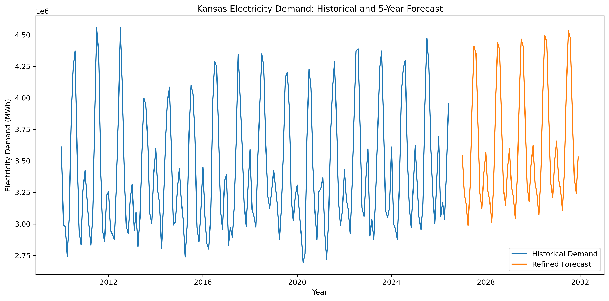
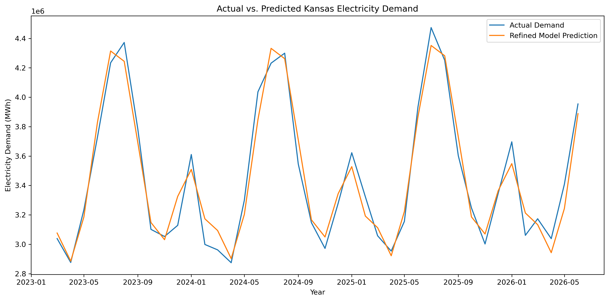
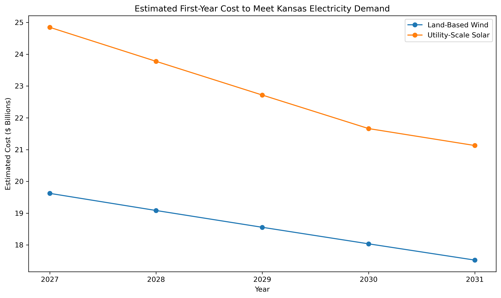
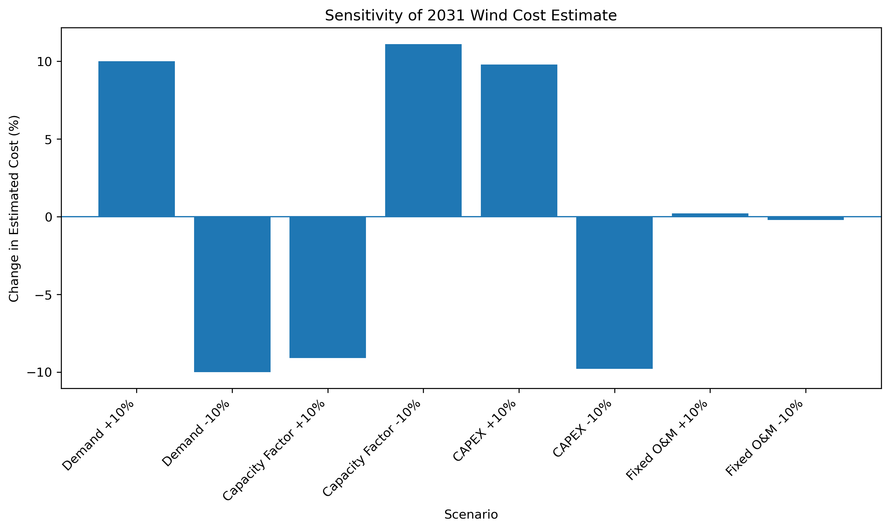

# Kansas-Clean-Energy-Cost-Forecast

## Project Overview
This project I am estimating electricity demand in Kansas over the next five years and estimating the cost of meeting that demand only using wind and solar power. I am using historical data to build a linear regression model that forecasts demand over the next five years. This will help stakeholders see what the electricity demand is in Kansas for the next five years, how much it would cost to replace that demand with renewable energy, and then evaluate the trade-offs involved in future  clean energy projects.

## Research Questions
1. What will electricity demand in Kansas be over the next five year?
2. How much wind or solar capacity would be required to meet that demand?
3. What would it cost to meet the forecasted demand using only land-based wind or utiility-scale solar?
4. Which assumptions have the greates effect on the estimated cost? (Sensitivity Analysis)

## Data Sources
U.S Energy Information Administration:
https://www.eia.gov/electricity/data.php
Annual Technology Baseline - National Laboratory of the Rockies:
https://atb.nlr.gov/electricity/2025/data?

## Environment Setup
Clone the repository and navigate into the project folder:
git clone https://github.com/CCCKBrant/Kansas-Clean-Energy-Cost-Forecast.git cd Kansas-Clean-Energy-Cost-Forecast

Install required python packages:

pip install -r requirements.txt

Jupyter Notebooks are stored in "notebooks/" directory

Open "notebooks/01_data_exploration.ipynb"

## Project Structure
Kansas-Clean-Energy-Cost-Forecast/
├── data/
│   ├── raw/
│   └── processed/
├── images/
├── notebooks/
├── src/
├── reports/
├── requirements.txt
└── README.md

# Data Cleaning and Preperation

## EIA Electricity Data
The EIA dataset provided historical information over monthly electricity data for multiple states. The dataset was already well cleaned, and I filtered the dataset to only use Kansas data and electricity sales measured in Megawatt Hours as the measure for electricity demand. I then used the past 15 years of monthly data converted into a datetime format, and sorted observations chronologically to create engineered features to make my refined linear regression model.

## ATB Wind and Solar Data
The ATB (Annual Technology Baseline) dataset contained information covering technology and cost information. Because the data has many technological parameters, the data had many missing values due to specifications for that technology. I filtered to include information regarding Land Based Wind and Utility Based Solar Energy. I used capacity factor, capital expenditure (CAPEX), and fixed operating & maintenance costs for performance variables. I then reshaped the dataset so that each technology and year had one row containing its capacity factor, CAPEX, and fixed O&M.

All datasets were then stored in the data/processed/ folder so I could use them for forecasting and my cost model.

# Methodology

## Demand Forecasting
I used a linear regression model to forecast monthly electricity demand in Kansas. Because the data is chronological, instead of using train_test_split(), I manually split the historical data to train on the first 80% of data, and test on the last 20%. The features used were month and time index. To use month as a feature, I had to one-hot encode it so the model could account for seasonal electricity demand patterns, while time inded represented the long-term trend in demand.

## Model Evaluation and Refinement
The baseline linear regression model when compared to a random forest regressor model using MAE, RMSE, and R², tested better, so I continued refining my baseline model. Since long-term demand was being forced into a straight-line relationship, I squared the time index to allow the long-term demand trend to curve. After creating that new feature, I compared my refined model to my original model using the same metrics, and found that my refined model performed better without greatly exaggerating new differences in demand.

## Cost Estimation
I took the forecasted monthly demand data that I got from my model, grouped the monthly data into annual data, and combined it with the ATB Wind and Solar data to estimate cost to meed demand using Wind and Solar data. I did this by using capacity factor to calculate how much installed generation capacity would be required to meet electricity demand, then combined that value with CAPEX and Fixed O&M values to estimate the first-year costs of meeting that electricity demand. Wind and Solar energy was modeled seperate from eachother to compare the required capacity and costs for Wind and Solar.

## Sensitivity Analysis
I then conducted a sensitivity analysis using the 2031 land based wind cost estimation. The goal was to see if an increase or decrease in our assumptions affected estimated cost, and which affected cost the most. Electricity demand, capacity factor, CAPEX, and Fixed O&M were each increased and decreased by 10% while other varibales remained unchanged.

# Results

## Five-Year Electricity Demand Forecast

The refined linear regression model forecasts that Kansas electricity demand will gradually increase over the next five years. Annual predicted demand increases from approximately 42.47 million MWh in 2027 to approximately 43.91 million MWh in 2031. The forecast also continues the seasonal pattern seen throughout the historical electricity demand data, with higher demand during the summer months and lower demand during other parts of the year.

## Model Performance
The refined linear regression model performed better than the original baseline model. My original baseline model had an MAE of 93,857 MWh, an RMSE of 114,183 MWh, and an R² of 0.941. The refined model had an MAE of 87,172 MWh, RMSE of 100,866 MWh, and an R² of 0.954. The refined model follows seasonal changes in demand more closely through the test period, while some individual months still contain large prediciton errors.

## Wind and Solar Cost Comparison
The cost model showed that land based wind energy had a lower estimated first-year cost then utility solar sytems in every year from 2027-2031. The first-year costs for wind was $19.6 billion and $24.8 billion for solar. By 2031, wind costs decreased to $17.5 billion and solar costs decreased to $21.1 billion. The estimated costs decrease overtime because the ATB projects improvements in capacity factor, and reductions in technology costs in the future. 

## Sensitivity Analysis
The sensitivity analysis shows the electricity demand, capacity factor, and CAPEX have the greatest effect omn estimated cost for the 2031 land based wind scenario. Electricity demand has nearly a 1 to 1 relationship with estimated cost. Capacity factor had a large effect because higher capacity factor means each MW of installed wind capcaity generates more electricity on average. CAPEX also had a nearly 1 to 1 rleationship because increased construction costs matches increased estimated cost to meet demand. Fixed O&M had very little effect on estimated cost.  

# Limitations - What I Would Do With More Time
There are several assumptions that were made with this analysis. The forecasting model uses only monthly and time-based results to predict demand. It does not account for possible other factors that can influence demand such as weather, population, world events, and the economic environment. The cost model is also simplified, and does not include factors such as storage, transmission cost, grid effects, cost of existing energy infrastructure. That is why this model should be used for planning scenarios, rather than expecting exact predictions.

If I had more time, I would add additional information and data such as weather, population, and economic data, to improve forecasting accuracy. I would also include factors such as storage, transmission costs, grid effecrs, cost of existing infrastructure, and land for new infrastructure in my cost model, to improve cost accuracy. I would also like to include other current energy systems to compare costs, and compare impact from wind and solar, to other energy systems such as coal and oil. 